# jira-task-plugin

IntelliJ IDEA의 Git 흐름에 Jira를 끼워 넣는 플러그인입니다.

Jira를 대신 조작하지 않습니다. 에픽·스토리·작업은 사람이 스프린트 전에 Jira에서 전부 만들고
([RULE.md](RULE.md) 전제 A), 상태는 대부분 Jira automation이 옮깁니다. 플러그인은 그 계획을
**개발하는 동안 잊지 않게** 돕습니다 — 작업을 고르고, 커밋에 키를 붙이고, 커밋 전에 한 번 확인하고,
MR을 만들고, 이슈를 찾아봅니다.

> **사용 설명서(PDF)** [docs/manual/Jira-Task-사용설명서.pdf](docs/manual/Jira-Task-사용설명서.pdf)
> 아래 사용법을 화면과 함께 한 파일에 담았습니다. 팀에 새로 합류한 사람에게는 이 파일 하나를 건네면 됩니다.

## 사용법

설치부터 MR까지, 실제로 하는 순서대로 따라가면 됩니다.

| 단계 | 할 일 |
| --- | --- |
| 준비 | 1 준비물 확인 · 2 플러그인 설치 |
| 설정 | 3 설정 마법사 · 4 GitLab 연결 · 5 AI 초안 켜기 |
| 작업 시작 | 6 작업 고르기 · 7 상태 표시줄 · 8 툴 윈도우 |
| 커밋 | 9 이슈 키 자동 접두 · 10 AI로 메시지 쓰기 · 11 커밋 전 확인 · 12 플러그인 커밋 창 · 13 AI가 거절할 때 |
| MR | 14 MR 만들기 |
| 그 밖 | 15 이슈 검색·수정 · 16 이슈 키로 이동 |

## 준비

### 1. 준비물 확인

**위치** 터미널

시작 전에 확인할 것은 셋입니다.

- IntelliJ IDEA 2024.2 이상
- `git` 명령이 PATH에 있을 것
- **Claude Code** 또는 **Codex** CLI 설치 + 로그인 — AI로 커밋 메시지·MR 초안을 쓸 때만 필요합니다.
  둘 중 하나만 있으면 됩니다.

```bash
# 둘 중 쓰는 쪽만 확인하면 됩니다
claude --version
claude /login        # 로그인하지 않았다면

codex --version
codex login          # 로그인하지 않았다면
```

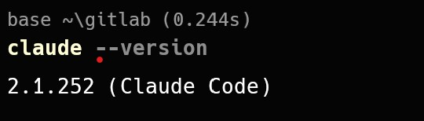

> **요금** API 키를 넣는 칸은 없습니다. 이미 로그인해 둔 CLI를 그대로 쓰므로 구독으로 동작합니다 —
> Claude Code는 Pro/Max, Codex는 ChatGPT 구독입니다.

### 2. 플러그인 설치

**위치** `Settings | Plugins`

팀에서 받은 `jira-task-plugin-<버전>.zip` 파일을 그대로 설치합니다.

1. <kbd>Ctrl</kbd>+<kbd>Alt</kbd>+<kbd>S</kbd> → **Plugins**
2. 톱니바퀴 ⚙ → **Install Plugin from Disk…** → 받은 zip 선택
3. **Restart IDE**로 다시 시작합니다.

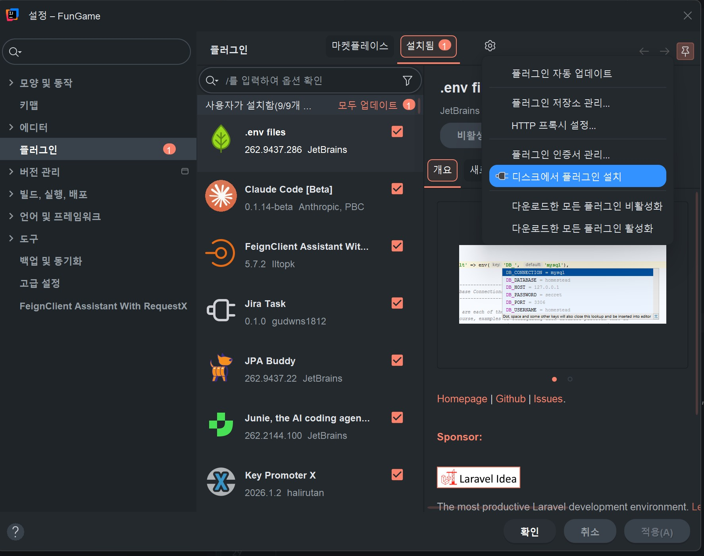

> **확인** 다시 시작한 뒤 `Tools > Jira Task` 메뉴가 보이면 설치된 것입니다.
> 오른쪽 사이드바에도 **Jira Task** 툴 윈도우가 생깁니다.

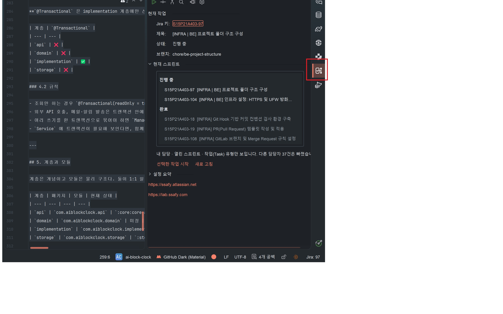

## 설정

### 3. 설정 마법사로 Jira 연결

**위치** `Tools > Jira Task > Run Setup Wizard`

설정이 없으면 IDE를 켠 직후 알림으로 안내합니다. 알림을 놓쳤다면 메뉴에서 직접 엽니다.

1. Jira 주소 · 이메일 · API 토큰을 넣습니다. 토큰은
   [Atlassian 계정 화면](https://id.atlassian.com/manage-profile/security/api-tokens)에서 만듭니다.
2. 프로젝트와 이슈 유형(스토리·작업·에픽)을 고릅니다.
3. 마지막 확인 화면에서 저장합니다.

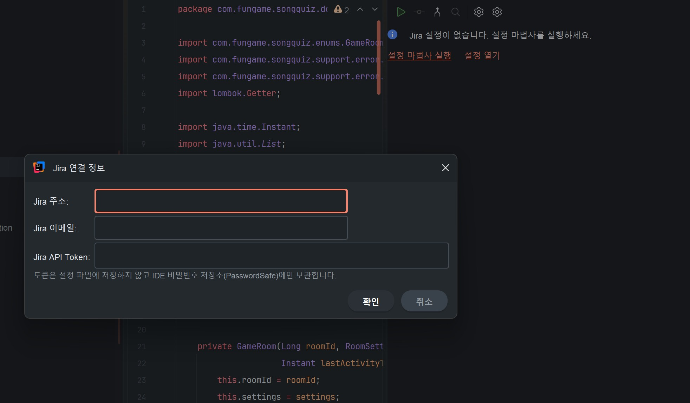

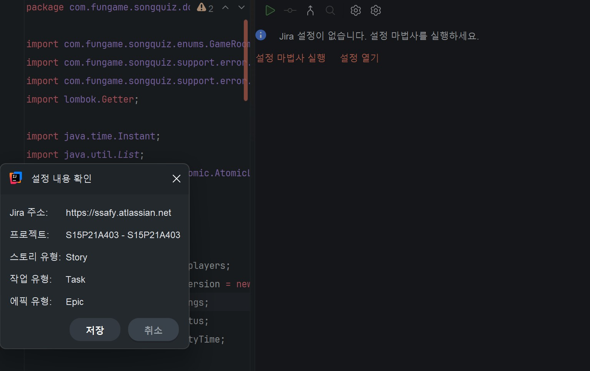

> **주의** 토큰은 IDE 비밀번호 저장소에만 저장되고 설정 화면에 다시 표시되지 않습니다.
> 한 번 넣으면 다시 넣을 일은 없습니다.

### 4. GitLab 연결

**위치** `Settings | Tools | Jira Task`

MR을 만들려면 GitLab 주소와 액세스 토큰이 필요합니다. 토큰에는 `api` 스코프가 있어야 합니다 —
`read_api`로는 조회만 되고 생성에서 막힙니다.

1. **GitLab 주소**와 **액세스 토큰**을 넣습니다.
2. **연결 테스트**를 눌러 통하는지 그 자리에서 확인합니다.
3. **Apply**로 저장합니다. 토큰 칸은 저장 후 비워집니다.

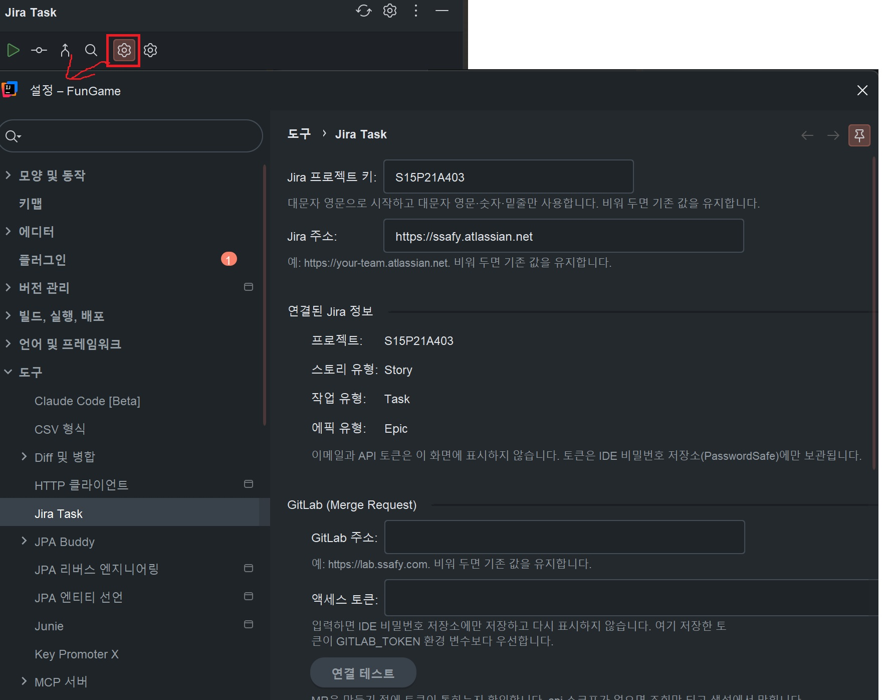

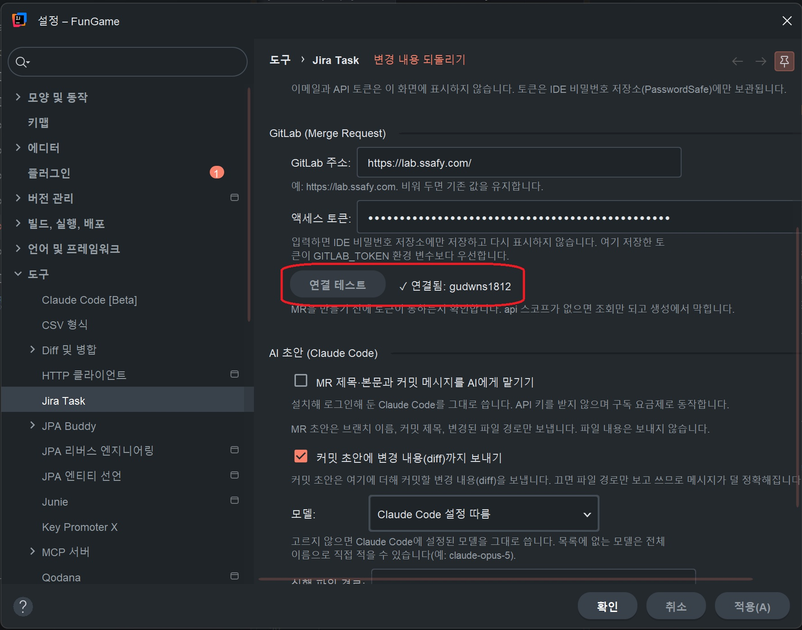

> **토큰 보관** GitLab 주소를 바꾸면 토큰을 다시 넣어야 합니다. 토큰은 주소마다 따로 보관합니다.

### 5. AI 초안 켜기

**위치** `Settings | Tools | Jira Task` → **AI 초안**

**기본값은 꺼짐**입니다. 켜야 커밋 메시지와 MR 초안을 AI가 씁니다.

- **MR 제목·본문과 커밋 메시지를 AI에게 맡기기** — 이 기능 전체의 스위치입니다.
- **사용할 AI** — **Claude Code**와 **Codex** 중에서 고릅니다. 고르면 옆에 `찾음: …`으로 어디에
  깔려 있는지 보여 주고, 없으면 설치 방법을 알려 줍니다. 방금 설치했다면 **새로고침**을 누릅니다.
- **커밋 초안에 변경 내용(diff)까지 보내기** — 켜져 있음이 기본입니다.
- **모델** — 비워 두면 그 CLI에 설정된 모델을 그대로 씁니다. 고른 AI마다 따로 저장하므로, AI를 바꿔도
  서로의 모델이 섞이지 않습니다.
- **실행 파일 경로** — **비워 두세요.** PATH와 npm·homebrew·공식 인스톨러가 쓰는 자리를 알아서 찾습니다.
  탐지가 실패했을 때만 터미널의 `where claude`(macOS는 `which claude`) 결과를 넣습니다.

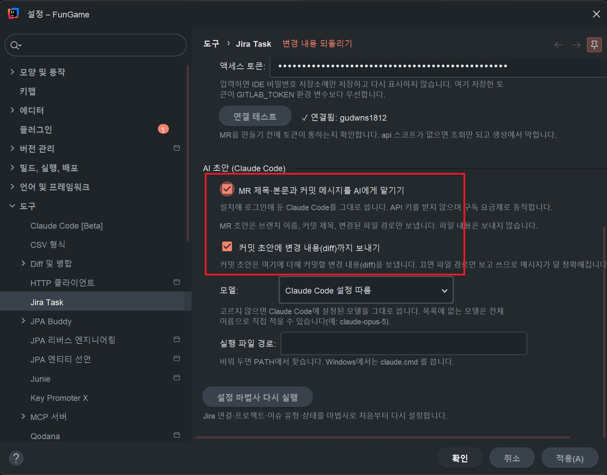

> **둘 다 깔려 있다면** 아무 때나 **사용할 AI**만 바꾸면 됩니다. 그 뒤의 커밋 초안과 MR 초안이 모두
> 바뀐 쪽으로 갑니다.

## 작업 시작

### 6. 오늘 할 작업 고르기

**위치** `Tools > Jira Task > Start Jira Task`

현재 스프린트의 작업을 목록에서 고릅니다. 고른 번호는 **저장소별로** 기억되므로 팀원과 섞이지 않고,
커밋할 때마다 이 번호로 이슈 키가 만들어집니다.

1. 목록에서 작업을 고르거나, 목록을 못 읽었으면 **작업 번호**를 직접 칩니다.
2. **작업 시작**을 누릅니다.

툴 윈도우의 현재 스프린트 목록에서 작업을 두 번 클릭해도 됩니다. 작업을 시작하면 Jira 상태도
`진행 중`으로 옮깁니다. 이미 진행 중이거나 끝난 작업은 그대로 둡니다.

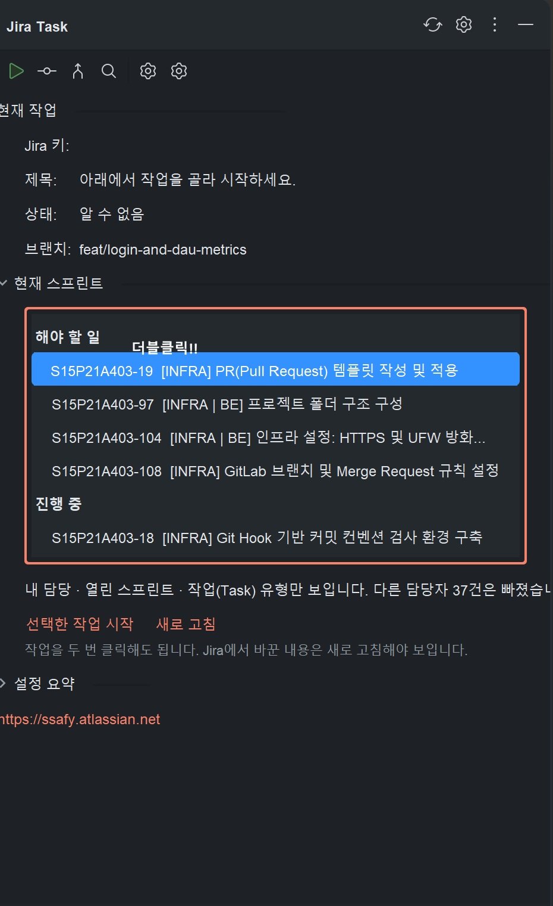

> **브랜치** 브랜치 이름에는 규칙이 없습니다. 브랜치는 평소처럼 만들고, Jira와의 연결은 커밋 메시지의
> 이슈 키가 담당합니다.

### 7. 상태 표시줄에서 현재 작업 보기

**위치** IDE 오른쪽 아래 상태 표시줄

지금 어떤 작업에 커밋하고 있는지 항상 보입니다. 눌러서 바로 다른 작업으로 바꿀 수도 있습니다.

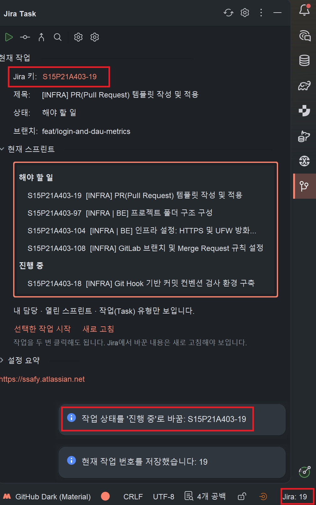

### 8. 툴 윈도우로 한눈에 보기

**위치** 오른쪽 사이드바 > **Jira Task**

현재 작업, 현재 스프린트 목록, 설정 요약이 한 화면에 있습니다. 스프린트 목록에서 작업을 두 번 클릭하면
그 작업으로 바꿉니다. Jira에서 바꾼 내용은 **새로 고침**을 눌러야 보입니다.

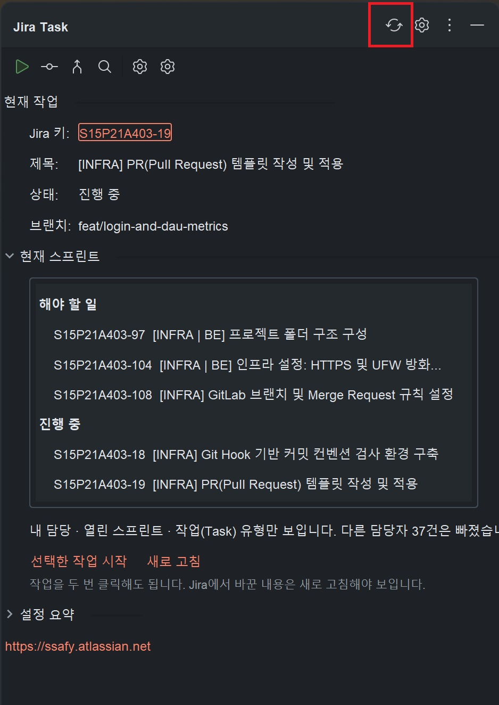

## 커밋

### 9. 이슈 키는 저절로 붙는다

**위치** IDE 커밋 창(<kbd>Ctrl</kbd>+<kbd>K</kbd>)

커밋 창을 열면 메시지 칸이 이미 이슈 키로 시작합니다. 직접 칠 필요도, 외울 필요도 없습니다.
키가 없는 커밋은 Jira가 보지 못합니다.

```text
[S15P11A601-152] 
```

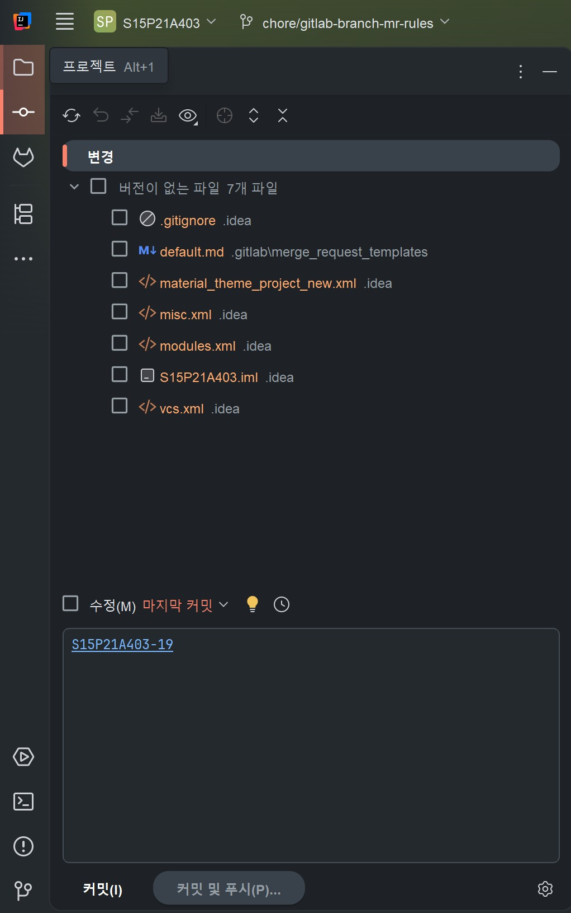

### 10. AI로 커밋 메시지 쓰기

**위치** 커밋 메시지 칸 옆 툴바 → **AI로 커밋 메시지 쓰기**

커밋할 변경을 읽어 제목 한 줄을 만들어 넣습니다. 이슈 키는 그대로 두고 그 뒤만 채웁니다.

1. 파일을 고칩니다. 저장하지 않아도, `git add` 하지 않아도 됩니다.
2. 메시지 칸 옆 전구 아이콘을 누릅니다. 메시지 히스토리(시계) 아이콘 바로 앞에 있습니다.
   누르면 칸에 진행 표시가 돌아갑니다.
3. 몇 초 뒤 초안이 채워집니다. 마음에 안 들면 그대로 고쳐 쓰면 됩니다.

```text
[S15P11A601-152] refactor: livekit 의존성 버전 명시 주석 제거
```

- `[S15P11A601-152]` — 플러그인이 붙입니다.
- `refactor:` — AI가 고릅니다.
- 나머지 — AI가 씁니다.

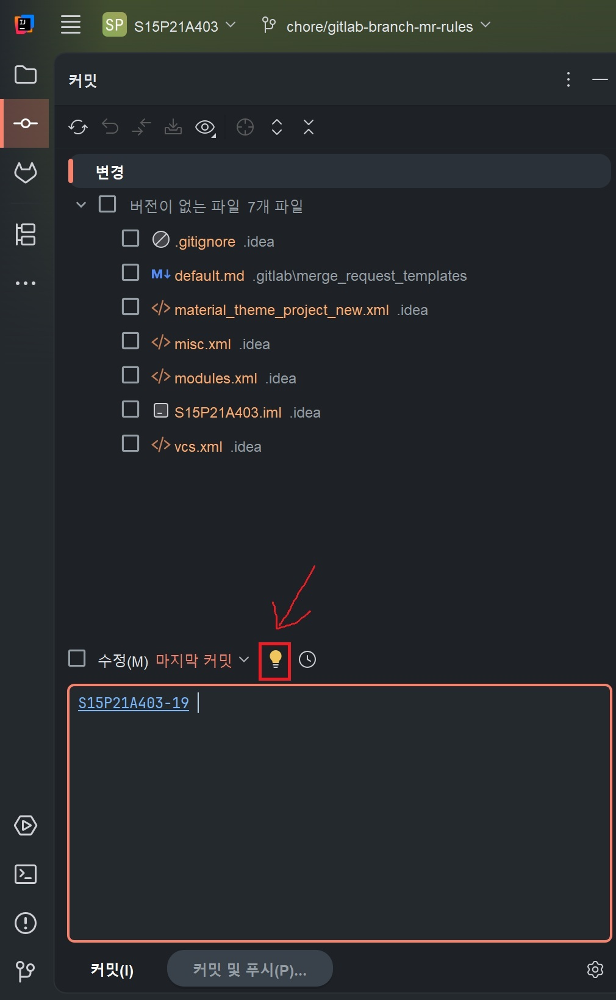

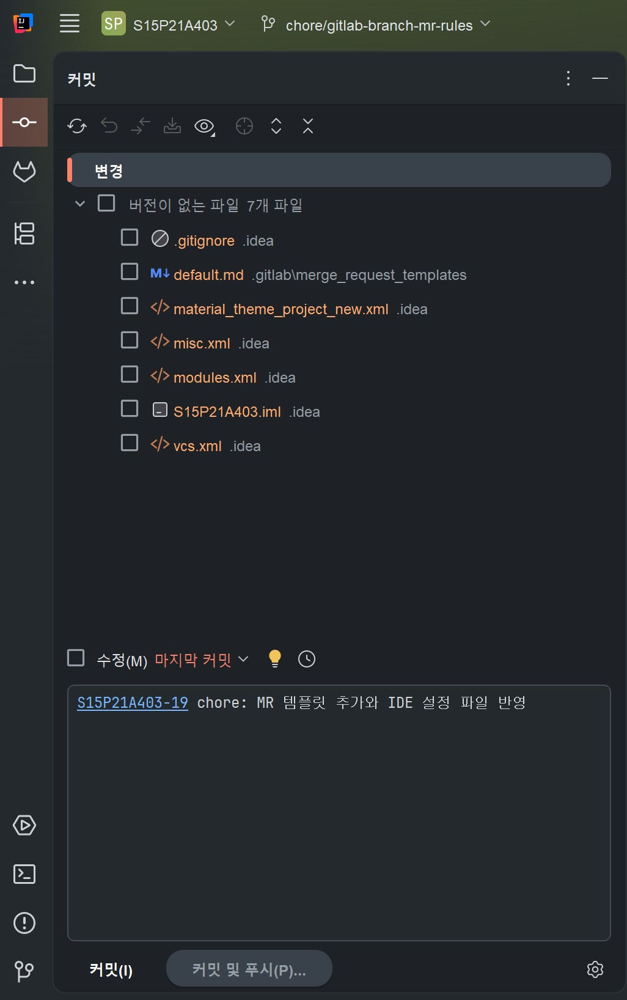

> **지키는 규칙** 접두사는 `feat` · `fix` · `docs` · `style` · `refactor` · `test` · `chore` 중 하나입니다.
> 제목은 언제나 한 줄이고, 본문은 붙지 않습니다.

> **쓰던 글이 있으면** 메시지 칸에 쓰던 메모가 있으면 그것을 참고해서 씁니다. 초안이 실패하면 쓰던 글은
> 그대로 둡니다.

### 11. 커밋 직전 확인

**위치** 커밋 버튼을 누른 직후

커밋 메시지를 한 번 봅니다. **막지 않고 경고만** 합니다. 언제나 **그래도 커밋**을 고를 수 있습니다.

| 경고 | 뜻 |
| --- | --- |
| 작업 키로 시작하지 않음 | Jira가 이 커밋을 보지 못합니다 |
| Jira에서 찾지 못한 키 | 키를 잘못 적었을 수 있습니다 |
| 현재 스프린트에 없는 작업 | 동결된 스프린트 밖의 일을 하고 있다는 뜻입니다 |

> **경고하지 않는 것** 끝난 작업에 커밋하는 것은 경고하지 않습니다. Jira에 물어보지 못했을 때(오프라인 등)도
> 경고하지 않습니다.

### 12. 플러그인 커밋 창으로 커밋하기

**위치** `Tools > Jira Task > Commit with Jira Task`

IDE 커밋 창 대신 쓰는 간단한 창입니다. **스테이지된 변경**을 커밋하며, 이슈 키는 자동으로 붙으므로
메시지만 칩니다. 여기에도 **AI로 쓰기** 버튼이 있습니다.

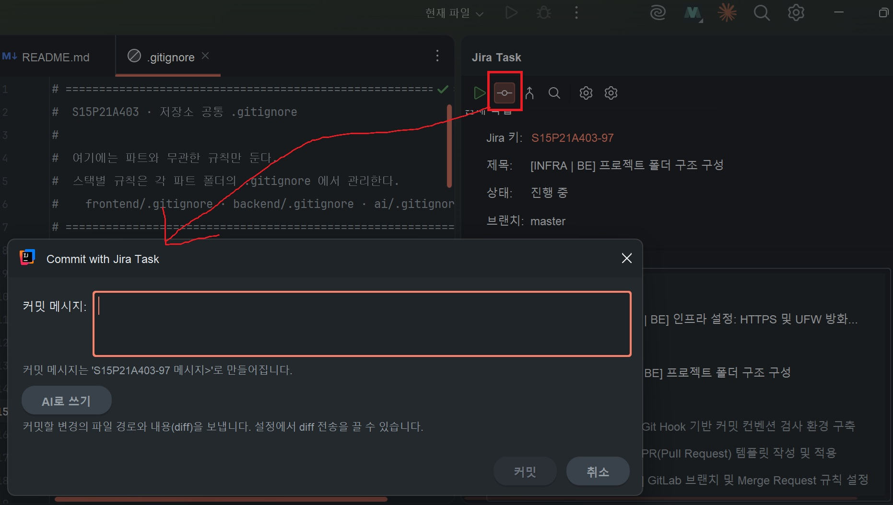

### 13. AI가 거절할 때

**위치** 알림(오른쪽 아래) 또는 창 안의 문구

초안이 실패해도 커밋은 막히지 않습니다. 이유는 언제나 문장으로 나오고, 대개 다음 중 하나입니다.

| 문구 | 할 일 |
| --- | --- |
| AI 초안이 꺼져 있습니다 | [5단계](#5-ai-초안-켜기)에서 켭니다 |
| … CLI를 찾을 수 없습니다 | 설치한 뒤 설정에서 **새로고침**을 누릅니다. 그래도 못 찾으면 실행 파일 경로를 지정합니다 |
| 설정에 적어 둔 경로로 …을(를) 부를 수 없습니다 | 그 칸을 비우면 알아서 찾습니다 |
| 커밋할 변경이 없습니다 | 파일을 고친 뒤 다시 누릅니다 |
| …이(가) 제때 답하지 않았습니다 | 잠시 뒤 다시 누르거나 직접 씁니다 |

## MR

### 14. MR 만들기

**위치** `Tools > Jira Task > Create Merge Request`

현재 브랜치의 커밋에서 작업 키를 모아 GitLab MR을 만듭니다. 그 키가 본문에 적혀야 Jira가 이 MR을
작업에 붙입니다.

1. 브랜치를 먼저 푸시합니다. 올리지 않은 브랜치는 확인 창이 막습니다.
2. 메뉴에서 **Create Merge Request**를 엽니다.
3. **대상 브랜치**를 고릅니다. 바꾸면 본문과 작업 키를 그 기준으로 다시 만듭니다.
   통합 브랜치(`backend-dev` 등)를 쓴다면 꼭 확인하세요.
4. 저장소에 MR 템플릿이 있으면 고릅니다. 템플릿 글자는 지우지 않고 관련 이슈 절만 채웁니다.
5. 담당자·리뷰어·라벨은 오른쪽의 **고르기**로 정합니다.
6. 필요하면 **AI로 다시 쓰기**로 제목·본문을 다듬습니다.
7. **MR 만들기**를 누릅니다.

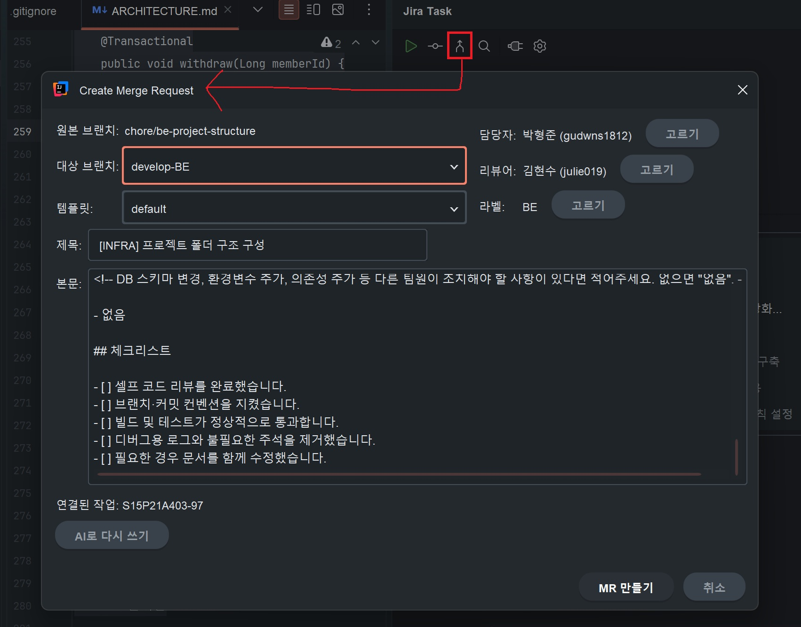

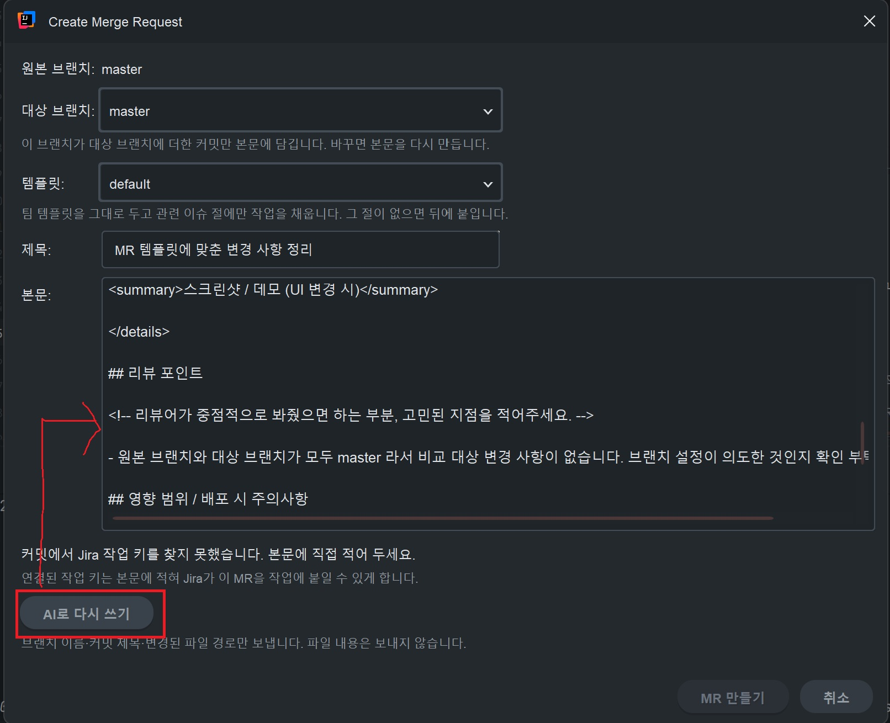

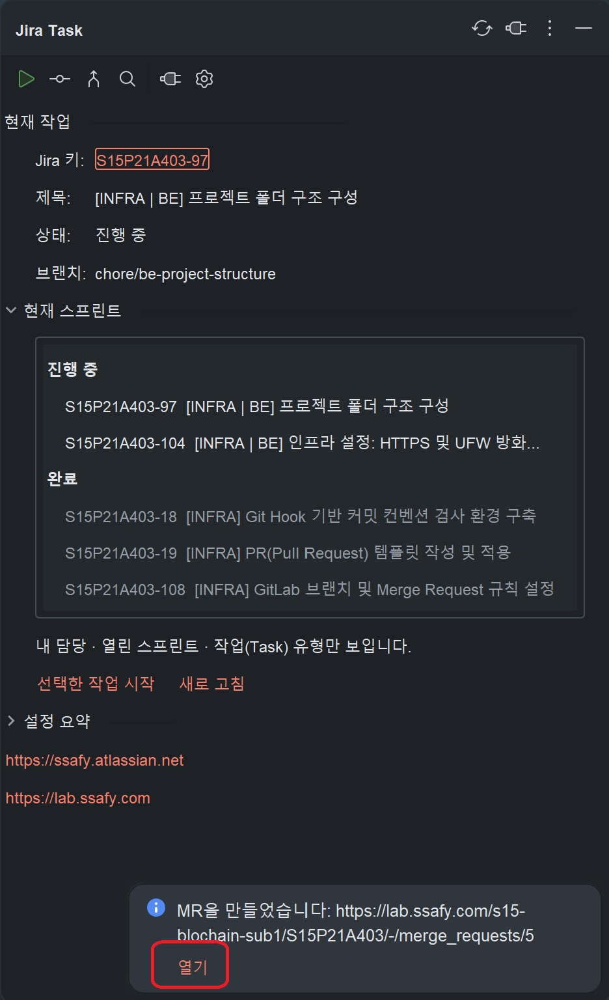

> **막힐 때** "이 저장소의 remote는 …인데 설정된 GitLab은 … 입니다"가 뜨면 설정의 GitLab 주소와
> 저장소의 remote 주소가 다른 것입니다.

## 그 밖의 기능

### 15. 이슈 검색·간단 수정

**위치** `Tools > Jira Task > Search Jira Issues`

IDE를 떠나지 않고 이슈를 찾아 제목과 설명을 고칩니다. 검색어는 이슈 키, 번호, 제목의 일부 중 무엇이든
됩니다. **상태와 스프린트는 여기서 바꾸지 않습니다.**

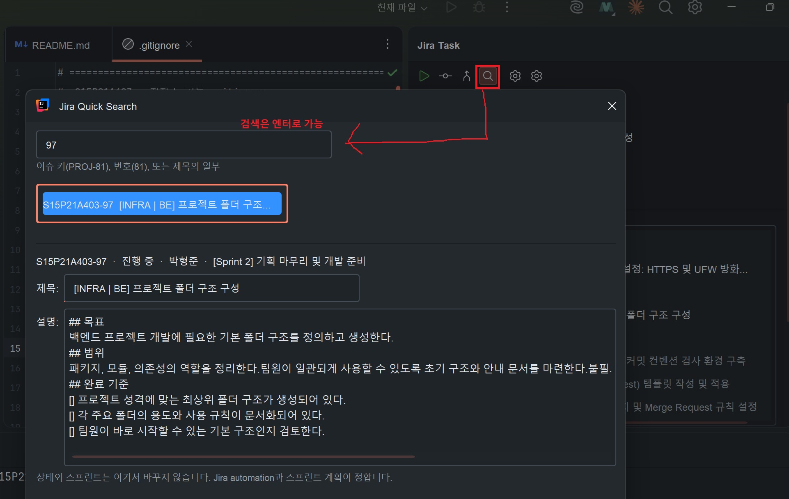

### 16. 이슈 키를 눌러 Jira로 가기

**위치** 커밋 메시지 · VCS 로그 · 주석 어디서나

이슈 키가 링크로 보입니다. 누르면 브라우저에서 그 이슈가 열립니다. 따로 설정할 것은 없습니다.

## 자격 증명과 AI에 보내는 것

- Jira API 토큰과 GitLab 액세스 토큰은 설정 파일에 저장하지 않고 IDE 비밀번호 저장소(PasswordSafe)에만
  보관합니다.
- `JIRA_EMAIL`·`JIRA_API_TOKEN` 환경 변수가 있으면 저장된 값보다 먼저 씁니다.
- GitLab 토큰은 반대로 **설정 화면에 저장한 값이 `GITLAB_TOKEN` 환경 변수보다 우선**합니다.
  환경 변수는 화면에 저장한 토큰이 없을 때만 씁니다.
- MR 생성에는 `api` 스코프와 프로젝트 Developer 이상 권한이 필요합니다.
- MR 초안이 AI에게 보내는 것은 **브랜치 이름·커밋 제목·변경된 파일 경로**뿐입니다. **파일 내용은 보내지 않습니다.**
- 커밋 초안은 여기에 더해 **커밋할 변경의 diff**를 보냅니다. 설정의 `커밋 초안에 변경 내용(diff)까지 보내기`를
  끄면 경로만 보냅니다.
- MR 템플릿은 저장소의 `.gitlab/merge_request_templates/`에서 찾습니다.

## 개발

### 구조

의존 방향은 `UI -> Application -> Domain`이고, `Infrastructure`는 Domain이 정의한 포트를 구현합니다.

```
domain/          커밋 메시지, 작업 번호, 스프린트 작업, MR 초안, 이슈 링크 규칙 (IntelliJ API 미의존)
application/     유스케이스: 작업 시작, 커밋, MR 생성, 초기 설정, 설정 편집, 상태 전환
infrastructure/  JiraClient·GitLabClient(HttpClient), PasswordSafe 자격 증명, 설정 저장소, git 실행, AI CLI
ui/              Settings 패널, 마법사·작업·커밋·MR·검색 다이얼로그와 액션, 툴 윈도우, 알림
```

설정은 애플리케이션 레벨 `PersistentStateComponent`(`jira-task.xml`)로 보관합니다.
자세한 설계는 [ARCHITECTURE.md](ARCHITECTURE.md)에 있습니다.

### 빌드와 실행

```bash
./gradlew test
./gradlew build
./gradlew buildPlugin
./gradlew runIde
```

`buildPlugin`은 설치 가능한 `build/distributions/jira-task-plugin-<version>.zip`을 만듭니다.
`runIde`로 뜬 샌드박스에서 `Tools > Jira Task` 메뉴와 `Settings | Tools | Jira Task`를 확인할 수 있습니다.

> `JAVA_HOME`이 JDK 21이 아니면 Gradle 8.10.2가 실행되지 않습니다. JDK 21을 명시해 실행합니다.
> 예: `JAVA_HOME="<JDK 21 경로>" ./gradlew.bat test`

### 사용 설명서 고치기

원본은 `docs/manual/index.html`이고, PDF는 그 페이지를 인쇄한 것입니다. 화면은 `docs/manual/capture.ps1 <번호>`로
다시 찍습니다(`.\capture.ps1 -List`로 번호별 내용 확인). 고친 뒤 PDF를 다시 만듭니다.

```bash
chrome --headless=new --no-pdf-header-footer \
  --print-to-pdf="docs/manual/Jira-Task-사용설명서.pdf" \
  "file:///<repo>/docs/manual/index.html"
```

`capture.ps1`은 `images/<번호>.png`로 저장합니다. 이 README는 `images/<번호>.jpg`를 가리키므로, 화면을 새로
찍었다면 README의 경로도 함께 바꿉니다.

### 작업 기록

Node.js CLI에서 플러그인으로 옮긴 이식 작업(T1~T26)의 단위와 결정 사항은
[MIGRATION-LOG.md](MIGRATION-LOG.md)에, 진행 중인 작업 목록은 [TASKS.md](TASKS.md)에 있습니다.
